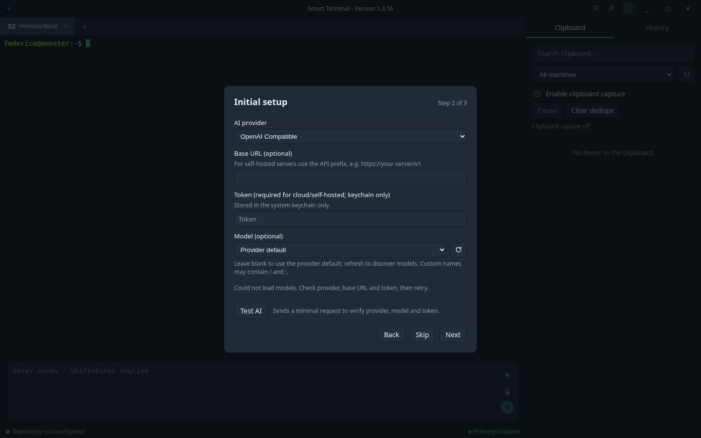

<!-- gsynchro:v1 id=cf2920b2-88e0-4939-a886-48bccc6095e8 registered=2026-10-23T13:00:27.389Z -->

# AI provider setup guide

AI actions are optional. In the reviewable modal, select an action and edit both its System Prompt and User Prompt before explicit Send. Settings → AI actions allows template editing and custom actions; changes are stored locally and are not synced. The same provider powers these actions and legacy correction; an action makes one request with a 15 s timeout. Nothing executes or submits automatically. Shell/PTY use is unaffected when no provider is configured.

## Local appearance configuration

`terminal_theme` (`dark` or `light`) is an optional key in machine-local `userData/config/config.md`, defaults to `dark`, and is unrelated to AI provider settings or tokens. Older app versions reject unknown config keys and may warn/reject the configuration after downgrade. This preference has no token implications.

## Provider choices

| Provider | Configuration |
| --- | --- |
| OpenAI Compatible | Provider, base URL, token, optional model. The endpoint must expose an OpenAI-compatible chat-completions API. |
| Claude Platform | Provider, optional base URL, token, optional model. |
| DeepSeek Platform | Provider, optional base URL, token, optional model. |
| None | Leaves AI unconfigured. |

Settings → AI field order is **AI Provider**, **Base URL**, **Token**, **Model**, **Test AI**. Legacy **OpenAI** and **Anthropic** values appear only when already saved.

The base URL must be `http(s)`, without credentials or query parameters. The model name is provider-specific. The model selector can refresh/discover chat models; **Provider default** omits a model, while **Custom** allows a manually entered model when discovery is unavailable or incomplete. Claude Platform and DeepSeek Platform presets auto-fill their base URLs.

## Self-hosted OpenAI-compatible / Unsloth

For a self-hosted OpenAI-compatible service, open the **AI** Settings tab (or the AI onboarding step), select **OpenAI Compatible**, and use these fields:

- **Base URL:** `https://unsloth.fvsg.mqu.it/v1`
- **Model:** `unsloth/gemma-4-26B-A4B-it-GGUF:UD-Q4_K_XL`
- **Token:** `sk-unsloth-...`

The `/v1` suffix is part of the base URL. These are configuration examples; this guide does not claim that the user's server has been tested.

## Token and keychain

Enter the token only in the token field; **never** in the data repository or a Markdown file. The main process stores it through the system keychain/Electron `safeStorage`. On Linux, if the backend is `basic_text`, `unknown`, or encryption is unavailable, the token is kept in memory for the current session only and a warning is displayed. Configure a secure keyring before relying on cloud AI after restart.

The renderer never receives the token; it only sees whether a token is present. Logout/revocation removes it. Tokens remain keychain-only; do not place them in templates, URLs, or Markdown.

Cloud STT can optionally reuse this AI base URL and token via **Use same AI provider (OpenAI-compatible)** in the STT tab.

## Test the provider

Click **Test AI**. Smart Terminal uses the current unsaved form values and the token entered in the form for this test; it does not require saving first. It sends a fixed minimal prompt through the main process, waits up to 8 seconds, and reports success with latency/model or an actionable error. It does not log your terminal text and does not execute commands. **Save** persists the non-secret configuration and token through the keychain.

Error messages include a sanitized HTTP status when the provider returns one. Common causes are a missing `/v1` suffix, a missing token, a model name the server does not expose, or network/TLS problems.

| Result | Action |
| --- | --- |
| **AI responded in … ms** | Configuration works; continue setup. |
| **AI provider is not configured** | Select a provider. |
| **AI token is not configured** | Enter a token and save it in the keychain. |
| **AI request timed out** | Check network/base URL/provider status and retry. |
| **Provider error** | Verify token, base URL, model and provider status. |

You can skip AI or save without a token; the terminal remains fully functional.

## Review before sending

Clicking **AI** in the assisted input applies a correction to the editable draft and shows **“AI correction applied: review before sending.”** Nothing is sent automatically. Shell-like input is skipped conservatively so commands are not rewritten. AI/STT errors never block the terminal.
